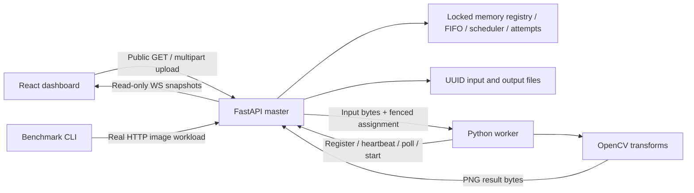

# Implemented architecture

The master runs one Uvicorn process. TaskStore uses an RLock around workers, queue membership, assignments, delivery flags, histories and result publication. UUID task IDs and separately generated UUID file names prevent user filenames becoming storage paths.

1. Modern registration returns identity JSON and a private X-Worker-Session header. Online duplicate registration is rejected; offline registration rotates the session. Legacy clients keep static first-assignment compatibility only.
2. An independent worker thread samples psutil without blocking CPU sampling and sends heartbeats. Server monotonic receipt time drives timeout; UTC last_seen is display metadata. Unavailable resources are null. A lifecycle sweeper expires/requeues work without GET requests.
3. Multipart uploads validate type, bytes, decode, dimensions and parameters before publishing one task per image. Invalid batches remove staged files and publish no tasks.
4. Static round-robin or adaptive scoring chooses online idle eligible workers, one active task each. No running migration occurs. Scores/fallback/fairness are defined in phase5.md.
5. Polling delivers a private assignment generation once. Modern task/image actions require both current session and generation. Workers download bytes, process with OpenCV and upload PNGs; no shared filesystem is needed.
6. Result upload checks structure and locked ownership/state/generation, writes an exclusive complete file, then publishes completion. Current identical completion is idempotent; stale/different output cannot replace valid results.
7. Timeout/transient failure retries at the FIFO tail within MAX_TASK_ATTEMPTS, increments attempts on assignment and rotates generation. Inputs persist across retries. Old workers may still compute but cannot publish. Legacy tasks fail terminally rather than receiving insecure retries.
8. Dashboard public snapshots are copied under lock, then encoded/sent outside it. One client subscription reconnects with backoff and bounded polling fallback. Credentials and worker-only originals are excluded. Stored attempts provide recovery events; no invented audit log exists.
9. Benchmark CLI uses unchanged HTTP APIs, checks isolation/topology, correlates returned task IDs, retains raw samples and exports measured reports. It cannot switch runtime mode, delete tasks or stop workers.

Master restart loses all metadata, queue, histories and tokens; disk files remain but are not rediscovered. Restart workers explicitly and resubmit intentionally. No database, authenticated enrollment, TLS, message broker, ML or orchestration layer is implemented. Configuration scripts load inert KEY=value data with terminal precedence; no shell evaluation is performed.
